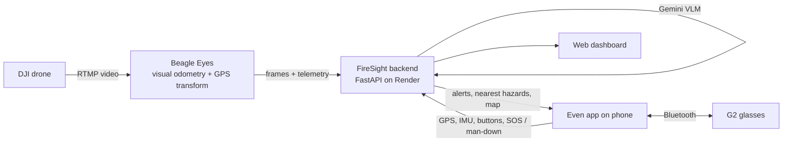

# FireSight

**The view from above, delivered to the people on the ground. Eyes up, hands free.**

FireSight connects a drone to smart glasses. AI reads what the drone sees, marks fire and hazards on a real map, and shows the wearer, on **Even Realities G2** glasses, where the nearest hazard is, how far away it is and whether it's getting closer. The glasses send the wearer's position and status back, so a coordinator sees everyone live on one map, including **SOS** and **man-down** alerts with exact coordinates.

**Live dashboard:** https://firesight-dashboard.onrender.com (free hosting; the first load after a quiet period can take up to a minute)

```
!! CRITICAL   09:52 AM                ┌────────────────────┐
DEMO FIRE ~70 M NE                    │ ▲          ████    │
                                      │          ██████    │
- Closing in: 30 m nearer             │      ◎             │
- Avoid heading NE                    │                    │
                                      │ ─ 75 m             │
                                      └────────────────────┘
          What the wearer sees on the G2 glasses
```

## Contents
- [Why FireSight](#why-firesight)
- [Features](#features)
- [How it works](#how-it-works)
- [Try it](#try-it)
- [Install and run on G2](#install-and-run-on-g2)
- [Connect the drone](#connect-the-drone)
- [AI map annotations (Gemini VLM)](#ai-map-annotations-gemini-vlm)
- [Configuration](#configuration)
- [API](#api)
- [Deployment](#deployment)
- [Project structure and development](#project-structure-and-development)
- [Limitations](#limitations)
- [Team](#team)

## Why FireSight

Drones already fly over wildfires, but their view usually stops at a screen: a command-post dashboard or a tablet someone has to stop and look down at. A hiker, a resident or a firefighter caught near a fire needs three answers fast: *where is the fire, how far away is it, and is it getting closer?*

| Today | FireSight |
|---|---|
| Drone video goes to a command post; people in the field hear about it over the radio | The drone's view becomes a one-line update in the wearer's line of sight |
| Maps and tracking live on phones and tablets you have to look down at | Hands-free on smart glasses, with no screen to check |
| Information is about the fire, not about *you* | Distance and direction from **your GPS position**, updated as you move |
| Man-down alarms sound locally, and command doesn't know where you are | **SOS and man-down reach the dashboard with your coordinates** in seconds |

## Features

**On the glasses**
- **Nearest hazard at a glance.** Distance and direction to the nearest mapped hazard (`Fire front ~160 m NE`), plus a trend line: *Closing in* / *Moving away*. The alert turns **CRITICAL** under 100 m.
- **Live mini-map.** North-up, with the wearer at the center and hazards at their true offset. The scale bar zooms as you approach, and the map redraws as you move.
- **Drone alerts.** AI-written alerts from drone frames (priority, headline, short instructions), cleared automatically when stale. `NO SIGNAL` shows if the connection drops.
- **SOS.** Hold a temple to send SOS with your location. Tap to cancel.
- **Fall detection.** A hard impact followed by stillness asks *"Are you OK?"*. With no tap within 20 s, the glasses report **MAN DOWN**.
- **Hands-free controls.** Tap acknowledges an alert (command sees it), swipe steps through nearby hazards, double-tap exits.

**On the dashboard**
- A map-first command view: live drone video, AI annotations on a 3D map with optional satellite imagery, and every wearer as a live marker showing motion (still / walking / tilted) and battery.
- **Red SOS / MAN DOWN banners** with coordinates. Click a banner to zoom to the wearer.
- A **G2 display card** showing exactly what each pair of glasses reported drawing.

**AI**
- **Gemini vision-language model (VLM)** analysis of drone frames, returning structured, glasses-sized alerts.
- **Open-vocabulary map annotations:** describe what to mark (*"fire, smoke, people"*), and detections are projected from the image onto real latitude/longitude.

## How it works



1. **See.** A DJI drone streams live video to **Beagle Eyes**. It tracks the camera's position with deep visual odometry (DPVO) and geo-references each frame with a GPS transform.
2. **Understand.** The backend analyzes frames with OpenCV or the **Gemini VLM**. Operator-prompted Gemini annotations mark hazards, and each one is projected from image pixels onto the ground as latitude/longitude.
3. **Deliver.** The G2 app polls the backend every 2 s for alerts and reports the wearer's GPS and sensor telemetry every 5 s. Each reply carries the nearest hazards, an alert built from the wearer's position, and a 288×144 map rendered for the glasses.
4. **Coordinate.** The dashboard shows the drone view, the annotations, every wearer, and SOS / man-down alerts.

## Try it

| Option | You need | Time |
|---|---|---|
| **Dashboard only** | A browser: open the [live dashboard](https://firesight-dashboard.onrender.com) | 1 min |
| **Glasses simulator** | A computer with Node.js 20+ and Python 3.10+ | 10 min |
| **Real G2 glasses** | G2 glasses, an iPhone or Android phone, and the report token (from the team, or your own backend) | 15 min |

## Install and run on G2

### Accounts, keys and tokens

| What | Needed for | How to get it | Where it goes |
|---|---|---|---|
| **Even Realities app** with an account | Real glasses | App Store / Google Play; pair the G2 glasses in the app | Your phone |
| **Developer Mode** | QR install | Enable it in the Even app's settings; a **Scan QR** button appears | — |
| **Even Hub developer portal** | Package install | Sign in with your Even Realities account; run `evenhub login` once | Upload `firesight.ehpk` here |
| **`G2_REPORT_TOKEN`** | Real glasses. Authorizes display reports, GPS, SOS and man-down. | **Hosted backend:** ask the team. **Your own backend:** any long random string (`openssl rand -base64 32`). | Backend environment **and** `glasses-app/.env.local` as `VITE_G2_REPORT_TOKEN` |
| **`GEMINI_API_KEY`** | Optional AI analysis and annotations | [Google AI Studio](https://aistudio.google.com/apikey) (the free tier has small daily limits) | **Backend only** (`.env`) |
| **`INGEST_TOKEN`** | Sending drone frames to a public backend | Generated by Render; ask the team | Drone sender only |

Everything in the glasses build can be extracted from the package, so the **only** secret it holds is `VITE_G2_REPORT_TOKEN`. Never put API keys or `INGEST_TOKEN` there.

### Tools (once)

```sh
node --version   # 20 or newer
npm install -g @evenrealities/evenhub-cli @evenrealities/evenhub-simulator
cd glasses-app && npm ci && cd ..
python3 -m venv .venv && .venv/bin/pip install -e .   # Python 3.10+, only for a local backend
```

### Option 1: simulator (no glasses)

```sh
# Terminal 1: local backend with a demo fire
G2_REPORT_TOKEN=local-test G2_DELIVERY_ENABLED=true FIRESIGHT_DEMO_HAZARD=true \
  .venv/bin/uvicorn firesight.api:app --port 8790

# Terminal 2: glasses app (the simulator has no GPS, so give it a position)
cd glasses-app
VITE_SUMMARY_URL=http://127.0.0.1:8790/latest VITE_G2_REPORT_TOKEN=local-test \
VITE_TEST_LOCATION=34.0702,-118.4450 npx vite --port 5173

# Terminal 3
evenhub-simulator http://localhost:5173
```

Within about 10 s the glasses show **"Demo fire ~160 m NE"** with a map. The simulator's buttons: **Long Press** = SOS, **Click** = acknowledge / cancel SOS, **Up/Down** = step through hazards. The dashboard is at http://127.0.0.1:8790.

### Option 2: real G2 with the hosted backend

```sh
cd glasses-app
npm run use-backend -- https://firesight-dashboard.onrender.com/
echo "VITE_G2_REPORT_TOKEN=<token from the team>" >> .env.local     # .env.local is git-ignored
```

Check the token. **`422` means it's correct** (the request deliberately sends an invalid position); `401` means it's wrong:

```sh
curl -s -o /dev/null -w "%{http_code}\n" -X POST https://firesight-dashboard.onrender.com/wearer \
  -H "Authorization: Bearer $(grep '^VITE_G2_REPORT_TOKEN=' .env.local | cut -d= -f2-)" \
  -H 'Content-Type: application/json' -d '{"lat":200}'
```

Then [install it on the glasses](#installing-on-the-glasses).

### Option 3: real G2 with your own backend

1. Start the backend as in Option 1, with your own long random `G2_REPORT_TOKEN`. Add `GEMINI_API_KEY` to `.env` if you have one.
2. Give it a public HTTPS address the phone can reach, and keep it running: `cloudflared tunnel --protocol http2 --url http://localhost:8790` (`brew install cloudflared`).
3. Build for that address:
   ```sh
   cd glasses-app
   npm run use-backend -- https://<your-tunnel>.trycloudflare.com
   echo "VITE_G2_REPORT_TOKEN=<same token as the backend>" >> .env.local
   ```
4. [Install it on the glasses](#installing-on-the-glasses). A tunnel restart gives a new address, so you'd need to build and install again.

### Installing on the glasses

**QR sideload** (quickest; the phone and computer must be on the same Wi-Fi):

```sh
cd glasses-app
npm run dev -- --host
evenhub qr --url "http://$(ipconfig getifaddr en0):5173"    # Linux: hostname -I
```

In the Even app, tap **Scan QR**. Campus and guest Wi-Fi often block this; if so, use the package instead.

**Package upload** (works anywhere):
1. **Increase `"version"`** in `glasses-app/app.json`. If the portal says it will *replace* an existing version, the phone keeps its old copy.
2. Run `npm run pack` → `glasses-app/firesight.ehpk`.
3. Upload it in the Even Hub developer portal, then update FireSight in the Even app.
4. **Fully restart:** double-tap to exit FireSight, force-quit the Even app, reopen it and launch FireSight.

On first launch, **allow Location** (precise, while using the app). The microphone permission is only used if voice reports are turned on.

### What to try

| Do this | What happens |
|---|---|
| Open FireSight | An alert and a map for the nearest hazard (e.g. *Demo fire ~160 m NE*); your marker appears on the dashboard |
| Walk toward the hazard | The distance drops, *Closing in* appears, then **CRITICAL** under 100 m; the map zooms in |
| Hold a temple | **SOS**: red marker and banner on the dashboard |
| Tap | Cancels SOS / "I'm OK"; otherwise acknowledges the alert |
| Swipe | Steps through nearby hazards |
| Drop the glasses on a soft surface and don't tap | *Are you OK?*, then **MAN DOWN** on the dashboard after 20 s |
| Double-tap | Exit, with the system confirmation |

### Troubleshooting

| What you see | Fix |
|---|---|
| **"Connecting to command..."** | The phone can't reach the backend. Open `<backend>/health` in the phone's browser, check the Even app shows the version you just uploaded, then fully restart FireSight. On the hosted backend, open the dashboard first so it wakes up. |
| **"NO SIGNAL - last update Xs ago"** | The backend or tunnel stopped, or the phone lost internet. It reconnects by itself. |
| **"Waiting for first update..."** with no hazard line | Nothing is mapped yet. Set `FIRESIGHT_DEMO_HAZARD=true`, or fly the drone with Gemini annotations. |
| Drone alerts never appear | Set `G2_DELIVERY_ENABLED=true` on the backend. |
| No marker on the dashboard | Run the token check (`422` = OK) and allow Location for the Even app. |
| The portal said "replace" and nothing changed | Increase `version`, pack, upload again. |

## Connect the drone

Drone processing runs in **[Beagle Eyes](https://github.com/sangregoriokimpo/beagle_eyes)** on a computer with an NVIDIA GPU.

```sh
./scripts/install_beagle_eyes.sh                                   # clones into vendor/beagle_eyes, builds DPVO (CUDA)
./scripts/install_beagle_eyes.sh vendor/beagle_eyes --skip-build   # no GPU: enough for the mock sender
```

Start a source (`conda activate visual_slam` for DPVO):

```sh
python3 vendor/beagle_eyes/broadcast/mock_sender.py              # simulated flight, no drone or GPU
python3 vendor/beagle_eyes/scripts/webcam_vo.py --detect-people  # laptop webcam + DPVO
python3 vendor/beagle_eyes/scripts/uav_vo.py \
  --config vendor/beagle_eyes/config/uav_config.yaml \
  --detect-people --gps-tf --gps-origin <launch lat>,<launch lon> --gps-autocal   # DJI Mini 5 Pro over RTMP
```

Beagle Eyes serves `ws://<host>:8765/ws` (live video and telemetry for the dashboard), `/snapshot` (paired frame + telemetry) and `/status`.

**Connecting it to FireSight:**
- **Push to a hosted backend (recommended):** on the backend set `INGEST_MODE=push` and `INGEST_TOKEN`. On the drone computer set `FIRESIGHT_URL=https://<backend>` and the same `INGEST_TOKEN`, then start Beagle Eyes. Frames and telemetry are pushed to `POST /ingest/beagle`. See [integrations/beagle_push](integrations/beagle_push/README.md).
- **Same machine or LAN:** the backend polls `BEAGLE_URL` (default `http://127.0.0.1:8765/snapshot`), and the dashboard's **System links** field (or `?beagle=<host>:8765`) points the browser at the live stream.

`--gps-tf` is what places annotations on the map. Without it, hazards can't be given coordinates, and the glasses can't show distances to them.

## AI map annotations (Gemini VLM)

In the dashboard's **Gemini annotations** card, type what to mark (or pick a preset), then press **Annotate now** or turn on **Auto**. Gemini returns regions in the frame. FireSight casts them onto the ground with the drone's camera pose, draws them on the map, and the glasses measure distance and direction to them. Annotations expire after 60 s.

Put the key in a git-ignored `.env` at the repository root: `cp .env.example .env`, then set `GEMINI_API_KEY`. Placement is approximate until the drone's scale is calibrated.

## Configuration

**Backend** (environment variables or `.env`):

| Variable | Default | Purpose |
|---|---|---|
| `G2_REPORT_TOKEN` | — | Shared secret for the glasses (display reports, `/wearer`). Required for glasses features. |
| `G2_DELIVERY_ENABLED` | `false` | `true` delivers drone-frame alerts to the glasses. GPS alerts, map, SOS and man-down work either way. |
| `INGEST_MODE` | — | `push` to accept frames from Beagle Eyes at `/ingest/beagle` |
| `INGEST_TOKEN` | — | Secret for frame ingestion (and uploads when public) |
| `PUBLIC_DEPLOYMENT` | — | `true` protects write endpoints with `INGEST_TOKEN` |
| `BEAGLE_URL`, `BEAGLE_EXPORT_TOKEN` | local | Poll Beagle Eyes snapshots instead of push |
| `FIRESIGHT_DETECTOR` | `auto` | `opencv`, `gemini`, or `auto` (Gemini if a key is set) |
| `GEMINI_API_KEY` | — | Enables Gemini analysis and annotations |
| `GEMINI_MODEL`, `GEMINI_ANNOTATE_MODEL` | built-in | Models for frame analysis and annotations |
| `FIRESIGHT_SCENARIO` | — | Path to a JSON field-context file; Gemini writes action instructions from it |
| `FIRESIGHT_GEMINI_FALLBACK` | — | `opencv` analyzes a frame locally when Gemini fails |
| `FIRESIGHT_DEMO_HAZARD` | — | `true` places a labeled demo fire near the first wearer (try GPS features without a drone) |
| `FIRESIGHT_DEMO_HAZARD_M` | `180` | Demo fire distance in metres |
| `FIRESIGHT_DEMO_MAP` | — | `true` adds the illustrative `/view.png` map to drone alerts |

**Glasses app** (`glasses-app/.env.local`):

| Variable | Purpose |
|---|---|
| `VITE_SUMMARY_URL` | Backend alert URL (set by `npm run use-backend`) |
| `VITE_G2_REPORT_TOKEN` | Must equal the backend's `G2_REPORT_TOKEN` |
| `VITE_FALL_G` | Fall threshold in g (default 3) |
| `VITE_DEVICE_ID` | Wearer name on the dashboard (default `g2`) |
| `VITE_TEST_LOCATION` | `lat,lon` for the simulator, which has no GPS |
| `VITE_ENABLE_VOICE_REPORTS` | `true`: hold records audio instead of sending SOS (no backend receiver yet) |

## API

| Endpoint | Purpose |
|---|---|
| `GET /latest` | Current drone alert for the glasses (`204` if none, stale, or delivery paused) |
| `POST /wearer` | Glasses report GPS + telemetry; the reply has the nearest hazards, a GPS-built alert and a `map_url` |
| `GET /wearer`, `GET /wearer/map.png` | Live wearers for the dashboard; the map image for a wearer's glasses |
| `POST /g2/display`, `GET /g2/status` | What the glasses displayed |
| `POST /ingest/beagle` | Paired frame + telemetry from Beagle Eyes (push mode) |
| `GET /live` | Latest analyzed drone frame and receiver status |
| `GET /annotations`, `POST /annotations/config`, `POST /annotations/run`, `DELETE /annotations` | Gemini map annotations |
| `POST /frame`, `POST /video`, `POST /latest` | Manual frame/video analysis and alert publishing |
| `GET /health` | Readiness check |

Full request and response details: [docs/api-contracts.md](docs/api-contracts.md).

## Deployment

`render.yaml` deploys the backend and dashboard to [Render](https://render.com) as one Docker service from `main`. It runs one worker with in-memory state, push ingestion and a public dashboard, and generates separate `INGEST_TOKEN` and `G2_REPORT_TOKEN` values; keep both private. Changing a setting restarts the service, which clears live wearers and alerts. On the free plan the service sleeps after about 15 minutes idle.

## Project structure and development

| Path | What's there |
|---|---|
| `src/firesight/api.py` | HTTP API and dashboard server |
| `src/firesight/analysis/` | OpenCV and Gemini frame analysis, annotation detection |
| `src/firesight/ingestion/` | Beagle Eyes push receiver and snapshot polling |
| `src/firesight/services/` | Annotations and geo projection, wearer GPS/telemetry, glasses maps, demo fire |
| `src/firesight/dashboard/` | Map-first web dashboard (HTML/CSS/JS, MapLibre) |
| `glasses-app/` | Even Realities G2 app (TypeScript, Even Hub SDK). See [glasses-app/README.md](glasses-app/README.md). |
| `integrations/` | Beagle Eyes sender and adapters |
| `demos/` | Frame and alert feeders for demos ([docs/demos.md](docs/demos.md)) |
| `deploy/`, `render.yaml` | Docker image and Render blueprint |
| `docs/` | Architecture, API contracts, testing |

Tests:

```sh
.venv/bin/pip install -e '.[test]'
FIRESIGHT_DETECTOR=opencv .venv/bin/python -m unittest discover -s tests
cd glasses-app && node --test tests/*.test.mjs
```

## Limitations

FireSight is a hackathon prototype, **not certified safety equipment** or evacuation guidance.
- **Directions are GPS compass directions** (N, NE, …). They're reliable beyond about 25 m. The glasses can't sense which way the head is turned (no magnetometer), and their "worn" flag doesn't change when they're taken off.
- **Hazard positions are approximate** until the drone's scale is calibrated. A single frame can't establish safe routes.
- **The dashboard and read endpoints are public,** so use demo imagery only. State is in memory and is lost on restart.
- **Not built yet:** a voice-report receiver (`POST /report`), offline mode, and read authentication.

## Team

Built at **LA Hacks 2026** by:
- [@sangregoriokimpo](https://github.com/sangregoriokimpo): drone pipeline (Beagle Eyes, GPS transform), Gemini map annotations
- Lucy Liu: frame analysis and Gemini integration
- [@lily1c](https://github.com/lily1c): dashboard, ingestion and deployment
- [@Dakshaarvind](https://github.com/Dakshaarvind): G2 glasses app, wearer GPS and telemetry, SOS and man-down
