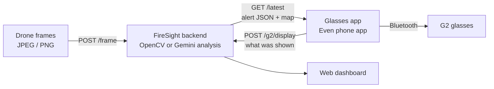

# FireSight

AI-powered drone intelligence for firefighters. Drone frames are analyzed for fire, and a short alert is shown hands-free on **Even Realities G2** smart glasses, with a web dashboard for the command side.

> **Try it yourself:** [DEMO.md](DEMO.md) walks through the whole pipeline, feeding frames to the API and seeing the analysis on G2 glasses or the simulator.

## How it works



1. **Frames in.** Each drone frame is sent to `POST /frame`.
2. **Analysis.** The backend analyzes it with the selected detector and publishes a compact alert (priority, headline, up to 5 instructions).
3. **Glasses.** The glasses app polls `GET /latest` every 2 seconds and draws the alert on the G2 display, with a map when one is provided.
4. **Dashboard.** The dashboard shows the latest alert and what the glasses app reports it displayed.

## Repository layout

```text
src/firesight/
  api.py           HTTP API and dashboard server
  frame.py         JPEG/PNG decoding and single-frame analysis
  detector.py      detector selection (OpenCV / Gemini)
  vision.py        OpenCV fire-color detection and frame-grid ranking
  gemini.py        Gemini vision analysis
  alerts.py        alert format and validation
  mapview.py       placeholder tactical map for the glasses
  video.py         OpenCV video sampling
  cli.py           command-line analyzer
  dashboard/       web dashboard (single HTML page, no build step)
glasses-app/       Even Realities G2 glasses app (TypeScript)
scripts/
  frame_feed.py    sends sample or custom frames to POST /frame on a loop
  demo_feed.py     publishes random prewritten alerts (no image analysis)
demo_scenario.json demo field data for Gemini's scenario mode
deploy/, render.yaml  Docker image and Render deployment
mock_server.js     minimal Node mock of GET/POST /latest
```

## Run the backend

Requires Python 3.10 or newer.

```sh
python3 -m venv .venv
.venv/bin/python -m pip install -e .
FIRESIGHT_DETECTOR=opencv .venv/bin/uvicorn firesight.api:app --port 8790
```

Open http://127.0.0.1:8790/ for the dashboard, then send a frame:

```sh
curl -X POST http://127.0.0.1:8790/frame -H 'Content-Type: image/jpeg' --data-binary @wildfire.jpeg
curl -i http://127.0.0.1:8790/latest
```

To send a stream of frames, use `scripts/frame_feed.py` (see [DEMO.md](DEMO.md)).

## Detectors

| `FIRESIGHT_DETECTOR` | What it does |
|---|---|
| `opencv` | Local fire-color detection. Free and offline. Reports *where* fire is in the frame, e.g. "Check upper-left frame sector". |
| `gemini` | Gemini vision model looks at the image. Requires `GEMINI_API_KEY`. `GEMINI_MODEL` overrides the default model. |
| `auto` (default) | Gemini if `GEMINI_API_KEY` is set, otherwise OpenCV |

Gemini options:

| Variable | Effect |
|---|---|
| `FIRESIGHT_SCENARIO=demo_scenario.json` | Scenario mode: Gemini combines the image with the field data in the file (wind, route, safe zone, hazards, crews) and writes action instructions. Without it, Gemini only describes where fire is visible. |
| `FIRESIGHT_GEMINI_FALLBACK=opencv` | If Gemini fails for a frame (e.g. a rate limit), analyze that frame with OpenCV instead of returning an error |

Gemini results are cached per image, so a repeated frame doesn't use API quota again. API keys are read from the environment only and never written to alerts or files.

## API

All endpoints allow cross-origin requests.

| Endpoint | Purpose |
|---|---|
| `POST /frame` | Analyze one JPEG or PNG (raw body with `Content-Type: image/jpeg` or `image/png`, or a multipart `frame` field), publish the alert and return it |
| `POST /video` | Analyze an uploaded video (multipart field `video`) with OpenCV and publish the strongest result |
| `POST /latest` | Publish a prepared alert directly |
| `GET /latest` | Latest alert as JSON. `204 No Content` if there is none or it is older than 30 seconds. |
| `GET /view.png` | Placeholder map image for the glasses (when `FIRESIGHT_DEMO_MAP=true`) |
| `POST /g2/display` | Glasses app reports what it displayed (requires `G2_REPORT_TOKEN`) |
| `GET /g2/status` | Last display report from the glasses app, read by the dashboard |
| `GET /live` | Live frame-receiver status, read by the dashboard |
| `GET /health` | Readiness check |

With `PUBLIC_DEPLOYMENT=true`, `POST /frame`, `/video` and `/latest` require `Authorization: Bearer <INGEST_TOKEN>` and are limited to 15 MiB.

### Alert format

```json
{
  "id": "1792277038391",
  "timestamp": "2026-10-17T22:42:10Z",
  "priority": "critical",
  "headline": "Fire spreading ahead and right",
  "instructions": [
    "Move down-right to creek trail",
    "Do NOT go back - spot fire 50m"
  ],
  "map_url": "/view.png?v=1792277038391&dir=upper-right"
}
```

- `priority` is `critical`, `warning` or `info`.
- The headline and each instruction are at most 40 characters, with up to 5 instructions.
- `map_url` is present only when `FIRESIGHT_DEMO_MAP=true`.

The glasses side of the format is documented in [glasses-app/SUMMARY_FORMAT.md](glasses-app/SUMMARY_FORMAT.md).

### Placeholder map

With `FIRESIGHT_DEMO_MAP=true`, each alert gets a 288×144 map for the glasses showing the wearer, an escape route and a safe zone, with the fire drawn in the part of the frame the analysis reported. The wearer, route and safe zone are illustrative, not measured.

## Dashboard

Served at `/` by the backend:
- the latest alert and its JSON
- manual frame upload and analysis
- an alert history for the browser session
- the **G2 glasses display monitor**: the alert available to the glasses, its map, and the last display report sent by the phone

The display report is what the glasses app reports it drew. It is not a screenshot of the glasses.

## Glasses app

See [glasses-app/README.md](glasses-app/README.md).

## Hosted deployment

`render.yaml` deploys the backend and dashboard to Render as one Docker service from the `feature/dashboard` branch. It runs OpenCV by default, with `PUBLIC_DEPLOYMENT=true`. Render generates separate `INGEST_TOKEN` and `G2_REPORT_TOKEN` values, which are kept private and never committed.

The service runs one worker and keeps state in memory, so restarts clear the current alert and display report. The free plan sleeps after inactivity, and the first request afterwards takes up to a minute. The dashboard and read endpoints are public, so use demo imagery only.

## Command-line analyzer

```sh
firesight-analyze path/to/frame.jpg --out alert.json
firesight-analyze path/to/drone_video.mp4 --sample-seconds 0.5 --out alert.json
```

## Limitations

- A single frame can't show safe routes, real-world distances, crew positions or compass directions.
  - OpenCV and default Gemini mode report only what is visible and where it is in the frame.
  - Scenario mode's routes and distances come from the scenario file, which in this repo is demo data.
- Neither detector is a verified fire assessment.
- Nothing in this project is evacuation guidance.
