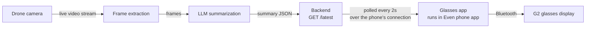

# FireSight Glasses App

The part of FireSight a firefighter actually sees: live, AI-generated instructions shown on **Even Realities G2** smart glasses, hands-free, with no phone to look at.

```
!! CRITICAL   04:11 PM
FIRE EXPANDING FURTHER AHEAD

- Move down-right along this path
- Do NOT go 50m back
- Regroup at creek crossing
```

Built by [@Dakshaarvind](https://github.com/Dakshaarvind).

## How it fits into FireSight



1. A drone streams live video of the fire.
2. The pipeline pulls frames from the stream and sends them to LLMs, which write a short situation summary with directions.
3. The backend keeps the latest summary and serves it as JSON at one URL.
4. **This app** runs inside the Even app on the firefighter's phone. Every 2 seconds it fetches that URL, and when the summary changes it redraws the glasses display.

The only link between the pipeline and the glasses is the JSON format in [SUMMARY_FORMAT.md](SUMMARY_FORMAT.md). Either side can change internally without breaking the other.

## What this app does

- **Shows the latest summary** as a priority tag (`!! CRITICAL`, `! WARNING` or `INFO`), the time, a headline, and up to 5 short instructions.
- **Warns when information is stale.** If the backend can't be reached for 15 seconds, the top line becomes `NO SIGNAL - last update 20s ago`. The last summary stays visible but is clearly marked as out of date, so a firefighter never acts on old directions without knowing it.
- **Handles bad data safely.** A malformed summary is ignored and the last good one stays up. Missing optional fields get defaults.
- **Fits the display.** The G2 canvas is 576×288 px, about 9 lines of 44 characters. Longer lines are cut off with `…` rather than wrapping off-screen.
- **Avoids unnecessary redraws.** The app only sends text to the glasses when the content actually changes, which saves Bluetooth bandwidth and battery.
- **Glasses controls:** tap a temple to fetch immediately. Double-tap to exit; the system confirmation dialog appears, as Even requires.

## Code

| File | What it does |
|---|---|
| [src/main.ts](src/main.ts) | Connects to the glasses, polls the backend, renders the display, handles taps |
| [src/summary.ts](src/summary.ts) | The summary type and validation of incoming JSON |
| [SUMMARY_FORMAT.md](SUMMARY_FORMAT.md) | The JSON contract for the backend team |
| [mock-server.mjs](mock-server.mjs) | Fake backend for testing without the drone pipeline |
| [app.json](app.json) | Even Hub manifest, including the network permission whitelist |
| [scripts/use-backend.mjs](scripts/use-backend.mjs) | Points the app at a backend URL (env + whitelist) |

Stack: TypeScript, Vite, [Even Hub SDK](https://www.npmjs.com/package/@evenrealities/even_hub_sdk) 0.0.16.

### SDK issues found and fixed

The starter code in Even's getting-started guide doesn't work with SDK 0.0.16:

- **Taps were ignored.** Input now arrives as `sysEvent`, not `textEvent` as the guide shows. The app handles both.
- **Hot reload broke the display.** The startup page can only be created once per session, so after a reload the app falls back to `rebuildPageContainer`.

## Run it

### Simulator

```sh
cd glasses-app
npm install
npm install -g @evenrealities/evenhub-cli @evenrealities/evenhub-simulator
npm run mock     # terminal 1: fake backend on http://localhost:8787/latest
npm run dev      # terminal 2: app on http://localhost:5173
evenhub-simulator http://localhost:5173   # terminal 3
```

The fake backend cycles through three sample summaries every 10 seconds. To push your own:

```sh
curl -X POST localhost:8787/latest -H 'Content-Type: application/json' \
  -d '{"priority":"critical","headline":"Fire ahead - move right","instructions":["Take the creek path"]}'
```

Stop the mock server to see the `NO SIGNAL` warning appear.

### Real glasses

```sh
npm run dev -- --host
evenhub qr --url "http://$(ipconfig getifaddr en0):5173"
```

Scan the QR code from the Even app with Developer Mode on. The phone and the computer must be on the same network.

### Point at a backend and package for Even Hub

```sh
npm run use-backend -- https://<backend>   # sets .env.local and the app.json whitelist
npm run pack                               # builds and writes firesight.ehpk
```

Upload `firesight.ehpk` through the Even Hub developer portal. To go back to the local mock, run `npm run use-backend -- http://localhost:8787`.

The backend must send `Access-Control-Allow-Origin: *` (see [SUMMARY_FORMAT.md](SUMMARY_FORMAT.md)). No API keys belong in this app; anything bundled into the `.ehpk` can be extracted.

## Next steps

- **Location-aware directions:** the SDK can read the phone's GPS. Sending each firefighter's position to the backend would let the LLM give personal directions ("move down-right") instead of general ones.
- **Alert on critical updates:** make new `critical` summaries more noticeable than routine ones.
- **Multiple crews:** serve a summary per crew or per firefighter.
