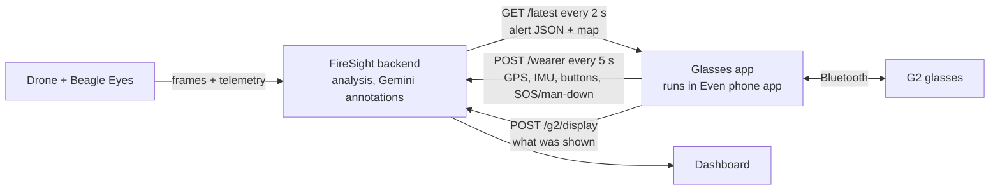

# FireSight Glasses App

The part of FireSight the wearer sees: live, AI-generated updates on **Even Realities G2** smart glasses, with distance and direction to mapped hazards, hands-free.

```
!! CRITICAL   04:11 PM
FIRE EXPANDING FURTHER AHEAD

- Move down-right along this path
- Do NOT go 50m back
- Regroup at creek crossing
```

Built by [@Dakshaarvind](https://github.com/Dakshaarvind).

**To run the full demo (frames → analysis → glasses), follow [DEMO.md](../docs/demos.md).**

## How it fits into FireSight



The app runs inside the Even Realities phone app. It polls the backend for the latest drone alert, reports the wearer's GPS and sensor telemetry, and gets back the nearest mapped hazards, an alert built from GPS and a map around the wearer.

## What this app does

- **Shows the latest alert:** a priority tag (`!! CRITICAL`, `! WARNING` or `INFO`), the time, a headline and up to 5 short instructions. Alerts older than 15 s are cleared; `NO SIGNAL - last update 20s ago` shows when the backend can't be reached.
- **Wearer GPS and hazards.** Every 5 s the app sends the phone's GPS to `POST /wearer`. The nearest mapped hazard is shown as e.g. `>> Fire front: ~180 m NE`. With no drone alert, the screen shows an alert built from GPS (distance, direction, "Closing in" / "Moving away") and a north-up map with the wearer at the centre.
- **Telemetry:** accelerometer samples (10 Hz), button presses with their source (right/left temple, R1 ring) and battery/charging go with each report. The dashboard shows motion (still/walking/tilted) and battery.
- **Fall check and SOS.** An impact above 3 g (`VITE_FALL_G`) followed by stillness asks "Are you OK? Tap to confirm"; no tap within 20 s reports **MAN DOWN**. Holding a temple sends **SOS**. Both appear on the dashboard with the wearer's position.
- **Controls:** tap = I'm OK / cancel SOS, otherwise acknowledge the alert; hold = SOS (or record a voice report when `VITE_ENABLE_VOICE_REPORTS=true`; the backend has no `/report` receiver yet); swipe = step through nearby hazards; double-tap = exit (with the system confirmation Even requires).
- **Fits the display:** 576×288 px, about 9 lines of 44 characters; text and the map image are only re-sent when they change.

Limits: directions are compass directions from GPS (unreliable within ~25 m); the glasses can't sense head direction (no magnetometer); their "worn" flag doesn't change when taken off.

## Code

| File | What it does |
|---|---|
| [src/main.ts](src/main.ts) | Connects to the glasses, polls the backend, renders the display, handles input |
| [src/location.ts](src/location.ts) | Phone GPS → `POST /wearer`; nearest hazards, GPS alert and map URL from the reply |
| [src/telemetry.ts](src/telemetry.ts) | IMU samples, button presses and device status sent with each report |
| [src/safety.ts](src/safety.ts) | Fall check, man-down and SOS state |
| [src/summary.ts](src/summary.ts) | Alert type and validation of incoming JSON |
| [src/voice.ts](src/voice.ts) | Packages microphone audio as WAV (voice reports, off by default) |
| [tests/](tests/) | Display and safety tests (`node --test tests/*.test.mjs`) |
| [app.json](app.json) | Even Hub manifest: network whitelist, location and microphone permissions |
| [scripts/use-backend.mjs](scripts/use-backend.mjs) | Points the app at a backend (`.env.local` and the whitelist together) |

Stack: TypeScript, Vite, [Even Hub SDK](https://www.npmjs.com/package/@evenrealities/even_hub_sdk) 0.0.16.

### SDK issues found and fixed

The starter code in Even's getting-started guide doesn't work with SDK 0.0.16:

- **Taps were ignored.** Input now arrives as `sysEvent`, not `textEvent` as the guide shows. The app handles both.
- **Hot reload broke the display.** The startup page can only be created once per session, so after a reload the app falls back to `rebuildPageContainer`.

## Install and run on G2

Three ways to try FireSight, from least to most setup:

| Option | You need | Best for |
|---|---|---|
| **A. Simulator** | A computer | Seeing the app with no glasses |
| **B. Real G2 + hosted backend** | G2 glasses, the team's Render backend and its report token | Judges and testers |
| **C. Real G2 + your own backend** | G2 glasses, a computer running the backend, a tunnel | Running everything yourself |

### Accounts, keys and tokens

| What | Needed for | How to get it | Where it goes |
|---|---|---|---|
| **Even Realities app** (iOS/Android) with a signed-in account | B, C | App Store / Google Play. Pair the G2 glasses in the app. | Your phone |
| **Developer Mode** in the Even app | B, C (QR install) | In the Even app's settings, enable Developer Mode. A **Scan QR** button then appears. | — |
| **Even Hub developer portal** access | B, C (package install) | Sign in with your Even Realities account; run `evenhub login` once on your computer | Used to upload `firesight.ehpk` |
| **`G2_REPORT_TOKEN`** | B, C. Lets the glasses report display, GPS, SOS and man-down to the backend. | **B:** ask the FireSight team (it's set on Render). **C:** make up any long random string, e.g. `openssl rand -base64 32` | Backend environment **and** `glasses-app/.env.local` as `VITE_G2_REPORT_TOKEN` |
| **`GEMINI_API_KEY`** | Optional. AI frame analysis and map annotations. | [Google AI Studio](https://aistudio.google.com/apikey) (free tier, ~20 requests/day on some models) | **Backend only** (`.env` or environment). Never in the glasses app. |
| **`INGEST_TOKEN`** | Only when sending drone frames to a public backend | Generated on Render; ask the team | Drone sender / frame feeder only. Never in the glasses app. |

Everything in the glasses build can be extracted from the package, so the **only** secret it ever holds is `VITE_G2_REPORT_TOKEN`.

### Tools to install (once)

```sh
node --version   # needs Node.js 20+
npm install -g @evenrealities/evenhub-cli @evenrealities/evenhub-simulator
cd glasses-app
npm ci
```

For option C you also need Python 3.10+ (backend) and [cloudflared](https://developers.cloudflare.com/cloudflare-one/connections/connect-networks/downloads/) (`brew install cloudflared`).

### A. Simulator (no glasses)

From the repository root, start a local backend with a demo fire:

```sh
python3 -m venv .venv && .venv/bin/pip install -e .
G2_REPORT_TOKEN=local-test G2_DELIVERY_ENABLED=true FIRESIGHT_DEMO_HAZARD=true \
  .venv/bin/uvicorn firesight.api:app --port 8790
```

In a second terminal:

```sh
cd glasses-app
VITE_SUMMARY_URL=http://127.0.0.1:8790/latest VITE_G2_REPORT_TOKEN=local-test \
VITE_TEST_LOCATION=34.0702,-118.4450 npx vite --port 5173
```

In a third terminal: `evenhub-simulator http://localhost:5173`. The simulator has no GPS, so `VITE_TEST_LOCATION` supplies a fixed position. Within ~10 s the glasses show **"Demo fire ~160 m NE"** with a map. Use the simulator's buttons: **Long Press** = SOS, **Click** = acknowledge or cancel SOS, **Up/Down** = step through hazards. The dashboard is at http://127.0.0.1:8790.

### B. Real G2 with the hosted backend (Render)

1. Get **`G2_REPORT_TOKEN`** from the team.
2. Point the app at the backend and add the token:
   ```sh
   cd glasses-app
   npm run use-backend -- https://firesight-dashboard.onrender.com/
   echo "VITE_G2_REPORT_TOKEN=<token>" >> .env.local
   ```
   `.env.local` is git-ignored. Check the token is accepted: `422` means correct (the request deliberately sends an invalid position), `401` means wrong.
   ```sh
   curl -s -o /dev/null -w "%{http_code}\n" -X POST https://firesight-dashboard.onrender.com/wearer \
     -H "Authorization: Bearer $(grep '^VITE_G2_REPORT_TOKEN=' .env.local | cut -d= -f2-)" \
     -H 'Content-Type: application/json' -d '{"lat":200}'
   ```
3. Install it on the glasses, using either method below.
4. Open https://firesight-dashboard.onrender.com in a browser. Your marker appears on the map within ~10 s.

The hosted backend's free plan sleeps after ~15 min idle: open the dashboard first and give it up to a minute to wake.

### C. Real G2 with your own backend

1. Start the backend as in option A (use a long random `G2_REPORT_TOKEN`; add `GEMINI_API_KEY` if you have one).
2. Give it a public HTTPS address the phone can reach, and keep this running:
   ```sh
   cloudflared tunnel --protocol http2 --url http://localhost:8790
   ```
3. Build for that address:
   ```sh
   cd glasses-app
   npm run use-backend -- https://<your-tunnel>.trycloudflare.com
   echo "VITE_G2_REPORT_TOKEN=<same token as the backend>" >> .env.local
   ```
4. Install it on the glasses (below). Restarting `cloudflared` gives a new address: build and install again.

### Installing on the glasses

**Method 1: QR sideload (fastest; phone and computer on the same Wi-Fi)**

```sh
cd glasses-app
npm run dev -- --host
evenhub qr --url "http://$(ipconfig getifaddr en0):5173"   # macOS; on Linux use: hostname -I
```

In the Even app, tap **Scan QR** and scan the code. Edits reload live. Campus or guest Wi-Fi often blocks phone-to-laptop traffic; if the phone can't connect, use Method 2.

**Method 2: package and upload (works anywhere)**

1. **Increase `"version"` in `app.json`** (e.g. `0.5.0` → `0.5.1`). If the portal says it will *replace* an existing version, the phone keeps its old copy.
2. Build the package:
   ```sh
   npm run pack    # writes glasses-app/firesight.ehpk
   ```
3. Upload `firesight.ehpk` in the Even Hub developer portal, then update FireSight in the Even app.
4. **Fully restart:** double-tap the glasses to exit FireSight, force-quit the Even app, reopen it, launch FireSight.

**On first launch, allow Location** (precise, while using) when the phone asks. FireSight also lists the microphone, used only when voice reports are turned on.

### What to try

| Action | What happens |
|---|---|
| Open FireSight | The alert and the map show the nearest mapped hazard, e.g. *"Demo fire ~160 m NE"*; your marker appears on the dashboard |
| Walk toward the hazard | Distance drops, *"Closing in"* appears, **CRITICAL** under 100 m, the map zooms in |
| Hold a temple | **SOS**: red marker and banner on the dashboard |
| Tap | Cancels SOS / confirms "I'm OK"; otherwise acknowledges the alert |
| Swipe | Steps through nearby hazards |
| Drop the glasses on a soft surface, don't tap | *"Are you OK?"*, then **MAN DOWN** on the dashboard after 20 s |
| Double-tap | Exit (with the system confirmation) |

### Backend settings that affect the glasses

| Variable | Effect |
|---|---|
| `G2_REPORT_TOKEN` | Required for display reports, GPS, SOS and man-down. Must equal the app's `VITE_G2_REPORT_TOKEN`. |
| `G2_DELIVERY_ENABLED=true` | Delivers **drone-frame alerts** to the glasses. When unset, `/latest` returns `204` (paused). GPS alerts, the map, SOS and man-down still work. |
| `FIRESIGHT_DEMO_HAZARD=true` | Places a labelled "Demo fire" 180 m NE of the first wearer, to try the GPS features without a drone. Real annotations replace it. |
| `GEMINI_API_KEY` | AI frame analysis and map annotations |

Changing a setting on Render restarts the service, which clears wearers and re-places the demo fire.

### Troubleshooting

| What you see | Likely cause | Fix |
|---|---|---|
| **"Connecting to command..."** | The phone can't reach the backend, or an older build points at an old address | Open `<backend>/health` in the phone's browser. Check the Even app shows the version you just uploaded. Fully restart FireSight. |
| **"NO SIGNAL - last update Xs ago"** | The backend stopped or restarted, or the phone lost internet | Check the backend and tunnel are running; it reconnects by itself |
| **"Waiting for first update..."** and no hazard line | No mapped hazards and no drone alert | Set `FIRESIGHT_DEMO_HAZARD=true`, or run the drone with Gemini annotations |
| Drone alerts never appear | Delivery paused | Set `G2_DELIVERY_ENABLED=true` on the backend |
| Your marker isn't on the dashboard | Token mismatch, or location not allowed | Run the `422`/`401` check above; allow Location for the Even app |
| Portal said "replace" and nothing changed | Same version number | Increase `version` in `app.json`, pack, upload again |
| Simulator shows no hazard | The simulator has no GPS | Set `VITE_TEST_LOCATION=lat,lon` |

Stack: TypeScript, Vite, [Even Hub SDK](https://www.npmjs.com/package/@evenrealities/even_hub_sdk) 0.0.16. Tests: `node --test tests/*.test.mjs`.
