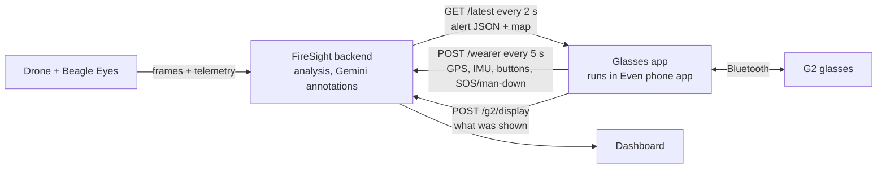

# FireSight Glasses App

The part of FireSight the wearer sees: live, AI-generated updates on **Even Realities G2** smart glasses, with distance and direction to mapped hazards, hands-free.

```
!! CRITICAL   04:11 PM
FIRE EXPANDING FURTHER AHEAD

- Move down-right along this path
- Do NOT go 50m back
- Regroup at creek crossing
```

Built by [@Dakshaarvind](https://github.com/Dakshaarvind).

**To run the full demo (frames → analysis → glasses), follow [DEMO.md](../docs/demos.md).**

## How it fits into FireSight



The app runs inside the Even Realities phone app. It polls the backend for the latest drone alert, reports the wearer's GPS and sensor telemetry, and gets back the nearest mapped hazards, an alert built from GPS and a map around the wearer.

## What this app does

- **Shows the latest alert:** a priority tag (`!! CRITICAL`, `! WARNING` or `INFO`), the time, a headline and up to 5 short instructions. Alerts older than 15 s are cleared; `NO SIGNAL - last update 20s ago` shows when the backend can't be reached.
- **Wearer GPS and hazards.** Every 5 s the app sends the phone's GPS to `POST /wearer`. The nearest mapped hazard is shown as e.g. `>> Fire front: ~180 m NE`. With no drone alert, the screen shows an alert built from GPS (distance, direction, "Closing in" / "Moving away") and a north-up map with the wearer at the centre.
- **Telemetry:** accelerometer samples (10 Hz), button presses with their source (right/left temple, R1 ring) and battery/charging go with each report. The dashboard shows motion (still/walking/tilted) and battery.
- **Fall check and SOS.** An impact above 3 g (`VITE_FALL_G`) followed by stillness asks "Are you OK? Tap to confirm"; no tap within 20 s reports **MAN DOWN**. Holding a temple sends **SOS**. Both appear on the dashboard with the wearer's position.
- **Controls:** tap = I'm OK / cancel SOS, otherwise acknowledge the alert; hold = SOS (or record a voice report when `VITE_ENABLE_VOICE_REPORTS=true`; the backend has no `/report` receiver yet); swipe = step through nearby hazards; double-tap = exit (with the system confirmation Even requires).
- **Fits the display:** 576×288 px, about 9 lines of 44 characters; text and the map image are only re-sent when they change.

Limits: directions are compass directions from GPS (unreliable within ~25 m); the glasses can't sense head direction (no magnetometer); their "worn" flag doesn't change when taken off.

## Code

| File | What it does |
|---|---|
| [src/main.ts](src/main.ts) | Connects to the glasses, polls the backend, renders the display, handles input |
| [src/location.ts](src/location.ts) | Phone GPS → `POST /wearer`; nearest hazards, GPS alert and map URL from the reply |
| [src/telemetry.ts](src/telemetry.ts) | IMU samples, button presses and device status sent with each report |
| [src/safety.ts](src/safety.ts) | Fall check, man-down and SOS state |
| [src/summary.ts](src/summary.ts) | Alert type and validation of incoming JSON |
| [src/voice.ts](src/voice.ts) | Packages microphone audio as WAV (voice reports, off by default) |
| [tests/](tests/) | Display and safety tests (`node --test tests/*.test.mjs`) |
| [app.json](app.json) | Even Hub manifest: network whitelist, location and microphone permissions |
| [scripts/use-backend.mjs](scripts/use-backend.mjs) | Points the app at a backend (`.env.local` and the whitelist together) |

Stack: TypeScript, Vite, [Even Hub SDK](https://www.npmjs.com/package/@evenrealities/even_hub_sdk) 0.0.16.

### SDK issues found and fixed

The starter code in Even's getting-started guide doesn't work with SDK 0.0.16:

- **Taps were ignored.** Input now arrives as `sysEvent`, not `textEvent` as the guide shows. The app handles both.
- **Hot reload broke the display.** The startup page can only be created once per session, so after a reload the app falls back to `rebuildPageContainer`.

## Install and run on G2

The full guide (accounts, keys and tokens, the simulator, real G2 with the hosted or your own backend, QR and package install, what to try and troubleshooting) is in the main README: **[Install and run on G2](../README.md#install-and-run-on-g2)**.

Quick reference, from this folder:

```sh
npm ci
npm run use-backend -- https://firesight-dashboard.onrender.com/     # or your backend
echo "VITE_G2_REPORT_TOKEN=<token>" >> .env.local                     # must match the backend's G2_REPORT_TOKEN
# increase "version" in app.json, then:
npm run pack                                                          # writes firesight.ehpk to upload in Even Hub
```

App settings (`.env.local`): `VITE_SUMMARY_URL`, `VITE_G2_REPORT_TOKEN`, `VITE_FALL_G` (fall threshold, default 3 g), `VITE_DEVICE_ID` (default `g2`), `VITE_TEST_LOCATION` (simulator only), `VITE_ENABLE_VOICE_REPORTS`.

Tests: `node --test tests/*.test.mjs`. Stack: TypeScript, Vite, [Even Hub SDK](https://www.npmjs.com/package/@evenrealities/even_hub_sdk) 0.0.16.
