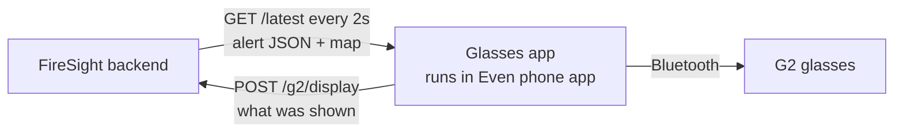

# FireSight Glasses App

The part of FireSight a firefighter sees: live alerts on **Even Realities G2** smart glasses, hands-free, with no phone to look at.

```
!! CRITICAL   09:52 PM                ┌────────────────────┐
FIRE SPREADING AHEAD AND RIGHT        │ ▲          ████    │
                                      │          ██████    │
- Move down-right to creek trail      │      ◎             │
- Do NOT go back - spot fire 50m      │    ╱               │
                                      │  □                 │
                                      └────────────────────┘
```

Built by [@Dakshaarvind](https://github.com/Dakshaarvind).

**To run the full pipeline (frames → analysis → glasses), follow [DEMO.md](../DEMO.md).**

## How it fits into FireSight



The app runs inside the Even Realities phone app. It fetches the latest alert from the backend every 2 seconds and draws it on the glasses. If a token is configured, it also tells the backend what it displayed, for the dashboard. The only contract with the backend is the API in [SUMMARY_FORMAT.md](SUMMARY_FORMAT.md).

## What it does

- **Shows the latest alert:** a priority tag (`!! CRITICAL`, `! WARNING` or `INFO`), the time, a headline, and up to 5 short instructions.
- **Shows a map when the backend sends one.** The display splits: headline top-left, a 288×144 map top-right, instructions below. The map image is only re-sent when it changes, because images are slow over Bluetooth.
- **Never shows stale information.** Alerts older than 15 seconds are cleared. If the backend can't be reached, the top line shows `NO SIGNAL - last update 20s ago`.
- **Handles bad data safely.** Malformed alerts are ignored.
- **Fits the display.** The G2 canvas is 576×288 px, about 9 lines of 44 characters. Longer lines are cut off with `…`.
- **Reports what it displayed** to `POST /g2/display`, but only after the glasses SDK accepts an update, plus a heartbeat every 5 seconds. It reports `failed` if an update is rejected. This needs `VITE_G2_REPORT_TOKEN`.
- **Glasses controls:** tap to fetch immediately. Double-tap to exit; the system confirmation dialog appears, as Even requires.
- **Voice reports (off by default).** With `VITE_ENABLE_VOICE_REPORTS=true`, holding a temple records from the glasses microphone and sends a WAV file to `POST /report` on the backend.

## Code

| File | What it does |
|---|---|
| [src/main.ts](src/main.ts) | Connects to the glasses, polls the backend, renders the display, reports display results, handles input |
| [src/summary.ts](src/summary.ts) | Alert type and validation of incoming JSON |
| [src/voice.ts](src/voice.ts) | Packages microphone audio as WAV |
| [tests/display.test.mjs](tests/display.test.mjs) | Display behaviour tests (`node --test tests/display.test.mjs`) |
| [SUMMARY_FORMAT.md](SUMMARY_FORMAT.md) | The backend API the app expects |
| [mock-server.mjs](mock-server.mjs) | Standalone fake backend with sample alerts and generated maps |
| [app.json](app.json) | Even Hub manifest, including the network whitelist |
| [scripts/use-backend.mjs](scripts/use-backend.mjs) | Points the app at a backend URL (`.env.local` and the whitelist together) |

Stack: TypeScript, Vite, [Even Hub SDK](https://www.npmjs.com/package/@evenrealities/even_hub_sdk) 0.0.16.

### SDK behaviour worth knowing

Even's getting-started sample doesn't work as written with SDK 0.0.16:

- **Taps** arrive as `sysEvent`, not `textEvent`. The app handles both.
- **The startup page** can only be created once per session, so after a hot reload the app uses `rebuildPageContainer` instead.

## Configuration

Set in `glasses-app/.env.local`, which git ignores:

| Variable | Purpose |
|---|---|
| `VITE_SUMMARY_URL` | Backend alert URL, e.g. `https://your-backend/latest`. Set it with `npm run use-backend`. |
| `VITE_G2_REPORT_TOKEN` | Must match the backend's `G2_REPORT_TOKEN`. Enables display reports. |
| `VITE_ENABLE_VOICE_REPORTS` | `true` turns on hold-to-record |

Everything in the built package can be extracted from it, so never put model API keys or the backend's `INGEST_TOKEN` here.

## Run it

Install once:

```sh
npm ci
npm install -g @evenrealities/evenhub-cli @evenrealities/evenhub-simulator
```

### Simulator

With a backend running (see [DEMO.md](../DEMO.md), or `npm run mock` for the standalone fake backend on port 8787):

```sh
VITE_SUMMARY_URL=http://127.0.0.1:8790/latest npx vite --port 5173
evenhub-simulator http://localhost:5173
```

### Package for real glasses

```sh
npm run use-backend -- https://<backend>   # sets .env.local and the app.json whitelist
# increase "version" in app.json
npm run pack                               # builds and writes firesight.ehpk
```

Upload `firesight.ehpk` through the Even Hub developer portal, then update FireSight in the Even app.

**Always increase `version` before uploading.** If the portal says it will replace an existing version, the phone keeps its old copy.

The backend must allow cross-origin requests (`Access-Control-Allow-Origin: *`) and must be reachable from the phone. `localhost` on the phone means the phone itself.
